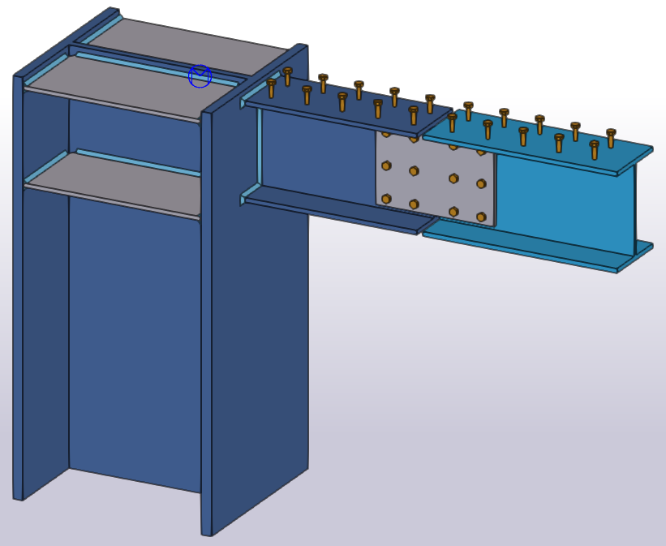
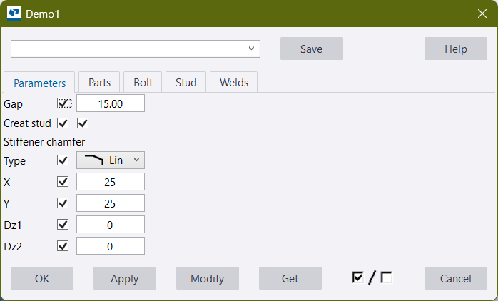
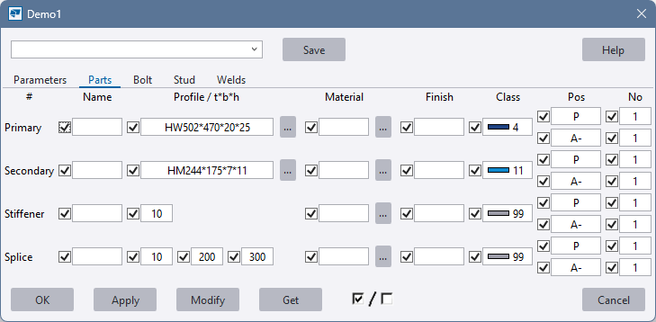
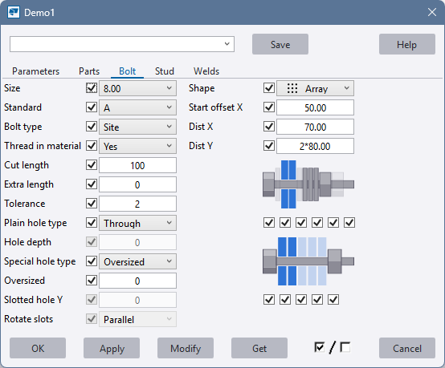
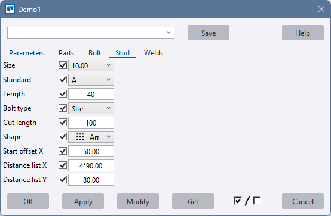
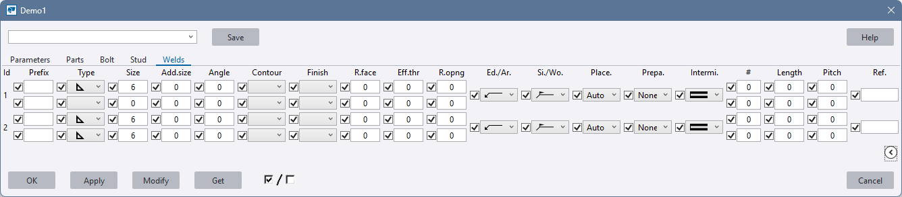

# Muggle.TsExtensions.CodingHelper

[中文版](Readme_zh-cn.md)

This is a tool to assist in developing Tekla Structures components. Its features include:
- Generate fields and utility methods for plugin data class, making it convenient to create or modify objects
- Generate fields for plugin class (if needed)
- Generate view model properties (if using a WPF interface)
- Generate a simple user interface

---

<!-- TOC -->
* [Muggle.TsExtensions.CodingHelper](#muggletsextensionscodinghelper)
  * [Generate Fields and Utility Methods for Plugin Data Class](#generate-fields-and-utility-methods-for-plugin-data-class)
    * [Example](#example)
  * [Generate Fields for Plugin Class](#generate-fields-for-plugin-class)
  * [Generate View Model Properties](#generate-view-model-properties)
  * [Generate User Interface](#generate-user-interface)
  * [Demo](#demo)
<!-- TOC -->

---

## Generate Fields and Utility Methods for Plugin Data Class

This generator provides the following set of attributes. Apply them to plugin data class as needed,
and set the property default values to generate the corresponding fields:

- PartAttribute
- PlateAttribute
- ChamferAttribute
- BoltAttribute
- StudAttribute
- WeldAttribute
- GeneralAttribute

> Object properties and their corresponding fields along with the plugin parameter name patterns follow [this document](AttributeNameReference.md).

It also generates a "SetFieldsToDefaultIfUnset" method, a series of "Create\*\<T>" and "ModifyTo\*\<T>" methods.

The SetFieldsToDefaultIfUnset method is used to set fields whose values have not been set in the user interface
to their default values.

The Create\*\<T> methods are used to create objects using the corresponding fields; 
the generic parameter is the type of object you want to obtain.

The ModifyTo\*\<T> methods are used to modify a given object using the corresponding fields.

### Example

Use the attributes in the plugin data class like this:

~~~csharp
// ====================
//    PluginData.cs
// ====================

[Part("main", Profile = "HM244*175*7*11")]
[Bolt(1, Shape = Circle, NumberOfBolts = 12, Diameter = 200)]
public partial class PluginData { }
~~~

Then, code similar to the following will be generated in the background:

~~~csharp
// ====================
//    PluginData.g.cs
// ====================

public partial class PluginData 
{
    [StructuresField("PTmainNAME")] public string PartMainName;
    [StructuresField("PTmainPRF")] public string PartMainProfile;
    [StructuresField("PTmainMATL")] public string PartMainMaterial;
    [StructuresField("PTmainFNSH")] public string PartMainFinish;
    [StructuresField("PTmainCLS")] public int PartMainClass;
    [StructuresField("PTmainPTP")] public string PartMainPartPrefix;
    [StructuresField("PTmainPTN")] public int PartMainPartStartNumber;
    [StructuresField("PTmainASMP")] public string PartMainAssemblyPrefix;
    [StructuresField("PTmainASMN")] public int PartMainAssemblyStartNumber;
    [StructuresField("B1SHAPE")] public int Bolt1Shape;
    [StructuresField("B1STD")] public string Bolt1Standard;
    [StructuresField("B1SIZE")] public double Bolt1Size;
    [StructuresField("B1DISTX")] public string Bolt1DistX;
    [StructuresField("B1DISTY")] public string Bolt1DistY;
    [StructuresField("B1NUM")] public int Bolt1NumberOfBolts;
    [StructuresField("B1DIAM")] public double Bolt1Diameter;
    [StructuresField("B1TYPE")] public int Bolt1Type;
    [StructuresField("B1THRD")] public int Bolt1ThreadInMaterial;
    [StructuresField("B1LEN")] public double Bolt1Length;
    [StructuresField("B1CLEN")] public double Bolt1CutLength;
    [StructuresField("B1XLEN")] public double Bolt1ExtraLength;
    [StructuresField("B1TOL")] public double Bolt1Tolerance;
    [StructuresField("B1PLAIN")] public int Bolt1PlainType;
    [StructuresField("B1DEPTH")] public double Bolt1BlindHoleDepth;
    [StructuresField("B1HOLTY")] public int Bolt1HoleType;
    [StructuresField("B1SLOTX")] public double Bolt1SlottedHoleX;
    [StructuresField("B1SLOTY")] public double Bolt1SlottedHoleY;
    [StructuresField("B1SOFFX")] public double Bolt1SlotOffsetX; // Depends on OpenAPI version
    [StructuresField("B1SOFFY")] public double Bolt1SlotOffsetY; // Depends on OpenAPI version
    [StructuresField("B1RSLOT")] public int Bolt1RotateSlots;
    [StructuresField("B1HOLE1")] public int Bolt1Hole1;
    [StructuresField("B1HOLE2")] public int Bolt1Hole2;
    [StructuresField("B1HOLE3")] public int Bolt1Hole3;
    [StructuresField("B1HOLE4")] public int Bolt1Hole4;
    [StructuresField("B1HOLE5")] public int Bolt1Hole5;
    [StructuresField("B1ISBOT")] public int Bolt1IsBolt;
    [StructuresField("B1NUT1")] public int Bolt1UseNut1;
    [StructuresField("B1NUT2")] public int Bolt1UseNut1;
    [StructuresField("B1WSHR1")] public int Bolt1UseWasher1;
    [StructuresField("B1WSHR2")] public int Bolt1UseWasher2;
    [StructuresField("B1WSHR3")] public int Bolt1UseWasher3;
    
    public void SetFieldsToDefaultIfUnset()
    {
        /* ... */
    }
    
    public T CreatePartMain<T>() where T : Part, new() 
    {
        /* ... */
    }
    
    public void ModifyToPartMain<T>(ref T part) where T : Part 
    {
        /* ... */
    }
    
    public T CreateBolt1<T>() where T : BoltGroup, new() 
    {
        /* ... */
    }
    
    public void ModifyToBolt1<T>(ref T bolt) where T : BoltGroup 
    {
        /* ... */
    }
}
~~~

Then, you can use it within the plugin class like this:

~~~csharp
// ====================
//    Plugin.cs
// ====================

[Plugin("Demo")]
public partial class Plugin : PluginBase 
{
    private PluginData Data { get; }
    
    public Plugin(PluginData data)
    {
        Data = data;
    }
    
    public override bool Run(List<InputDefinition> input) 
    {
        // Call this method first to set fields whose values have not been set to their default values
        Data.SetFieldsToDefaultIfUnset();
        
        /* ... */
        
        var main = CreatePartMain<Beam>(); // Create an object of type Beam
        main.StartPoint = p1;
        main.EndPoint = p2;
        main.Insert();
        
        /* ... */
        
        Beam beam = /* ... */ // Create an object of type Beam through other means
        ModifyToPartMain(ref beam);
        beam.Insert();
        
        /* ... */
        
        BoltGroup bolt = Data.Bolt1Shape switch 
        {
            1 => CreateBolt1<BoltCircle>(),
            2 => CreateBolt1<BoltXYList>(),
            _ => CreateBolt1<BoltArray>()
        };
        bolt.PartToBoltTo = main;
        bolt.PartToBeBolted = somePart;
        bolt.FirstPosition = p1;
        bolt.SecondPosition = p2;
        bolt.Insert();
        
        /* ... */
        
    }
    
    /* ... */
}
~~~

---

## Generate Fields for Plugin Class

If you find accessing plugin parameters like Data.PartMainProfile redundant, 
you can apply the "FieldsFromDataAttribute" attribute to the plugin class. 
The generator will then generate fields for the plugin class that correspond one-to-one with the plugin data class fields. 
Call the "GetFieldValuesFrom" method at the appropriate place, and you can then access plugin parameters like _partMainProfile.

---

## Generate View Model Properties

If you use a WPF user interface, apply the attributes provided in the 
[Generate Fields and Utility Methods for Plugin Data Class](#generate-fields-and-utility-methods-for-plugin-data-class) 
section to the view model (which implements the INotifyPropertyChanged interface), 
and the generator will automatically generate the related properties for the view model.

> The generator determines whether a class which these attributes are applied is a plugin data class or 
> a view model class based on whether this class implements the INotifyPropertyChanged interface.
> So you can simply copy the attributes already applied to the plugin data class to the view model class.

This generator also provides the following base classes to offer some common code:

- NotificationObject
- ConnectionViewModel
- DetailViewModel
- CustomPartViewModel

Among them, NotificationObject implements the INotifyPropertyChanged interface, 
while the other three classes inherit from NotificationObject and respectively provide common tab properties for 
Connection, Detail, and CustomPart type plugin.

Make view model inherit from one of them as needed to avoid reimplementing related code.

---

## Generate User Interface

Apply the "UserInterfaceAttribute" attribute to the plugin class to generate a simple user interface. 
On one hand, this makes debugging easer during the core logic development phase; 
on the other hand, it reduces the workload during the user interface development phase, 
because you can directly make slight edits based on the generated code.

Currently, supports INP and WPF; support for WinForm is planned for future versions.

> *Tip*: If the INP user interface content has changed but nothing actually shows up, 
> you need to delete a file like this path and restart Tekla Structures: 
> "C:\Users\\\<UserName>\AppData\Local\Trimble\Tekla Structures\2021.0\Runtime\plugins\\\<PluginName>.inp"

> ***Note***: When using the INP user interface, the weld parameters need to be filled in the dialog first, click Apply,
> and create the component, then the parameter values will take effect.
> If you create the component first and then open the dialog to edit the weld parameters and click Modify,
> the parameter values won’t take effect.  
> It’s not clear yet whether this is a bug in Tekla Structures itself, or if something in the generated code doesn’t
> comply with Tekla Structures standards. **If you know how to fix this issue, please contact with me**.

> ***Note***: Because the official implementation of source generators does not allow outputting files with extensions 
> other than .cs, when generating a WPF user interface, this generator bypasses the official approach and outputs 
> a "WpfUi.g.xaml" file in the project directory. However, this also brings a drawback — when the generated WPF 
> interface is no longer needed, this file must be deleted manually. (Although the WPF interface can be written in pure 
> C# code, but doing so would lose the second convenience mentioned above.)

---

## Demo

If there is anything you still do not understand, you can check out this 
[demo project](https://github.com/ThinkerHua/Muggle-Tekla-Structures-Extensions/blob/master/Demo1), 
or other plugin projects under that demo project's solution.

