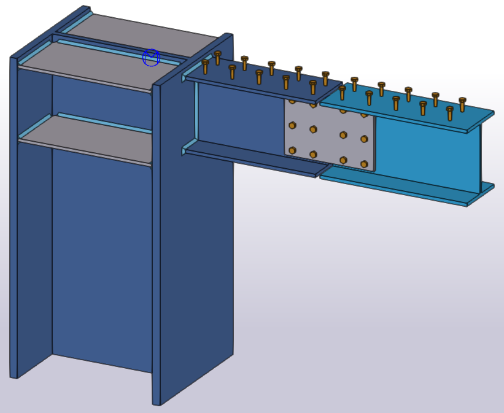
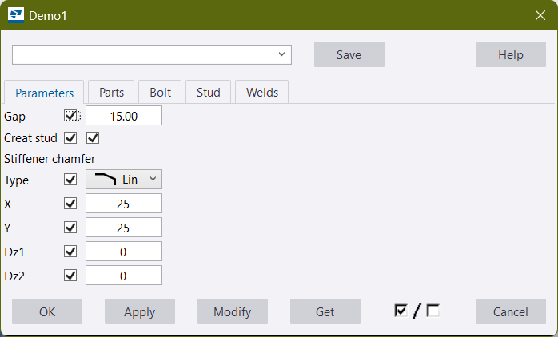
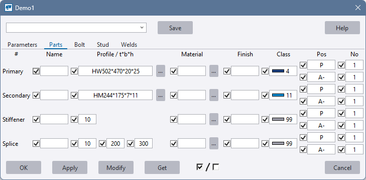
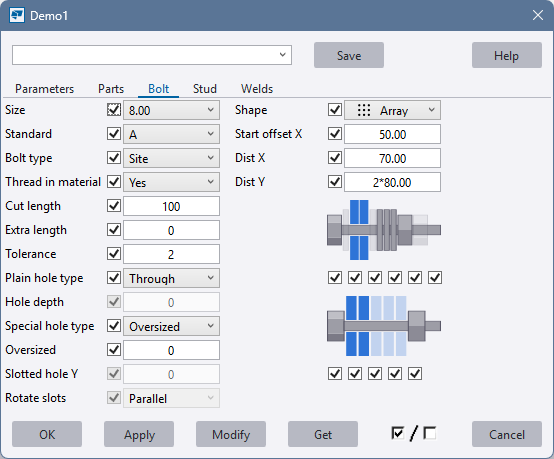
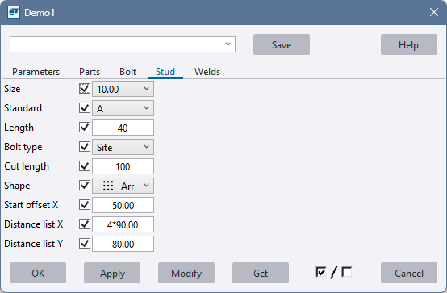
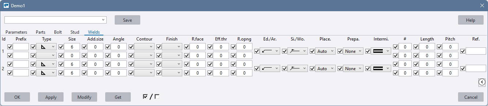

# Muggle.TsExtensions.CodingHelper

[English version](Readme.md)

这是一个辅助开发 Tekla Structures 组件的工具，其功能有：
- 生成组件数据类的字段和实用方法，便捷地创建对象或编辑对象
- 生成组件类的字段（如果需要）
- 生成视图模型的属性（如果使用 WPF 界面）
- 生成简易的用户界面

---

<!-- TOC -->
* [Muggle.TsExtensions.CodingHelper](#muggletsextensionscodinghelper)
  * [生成组件数据类的字段和实用方法](#生成组件数据类的字段和实用方法)
    * [示例](#示例)
  * [生成组件类的字段](#生成组件类的字段)
  * [生成视图模型的属性](#生成视图模型的属性)
  * [生成用户界面](#生成用户界面)
  * [演示](#演示)
<!-- TOC -->

---
## 生成组件数据类的字段和实用方法

本生成器提供了以下一组特性，根据需要将其应用于组件数据类上，同时设置属性默认值，即可生成对应的字段：

- PartAttribute
- PlateAttribute
- ChamferAttribute
- BoltAttribute
- StudAttribute
- WeldAttribute
- GeneralAttribute

> 对象属性与对应的字段及其标记的组件参数名模式遵循[此文档](AttributeNameReference_zh-cn.md)。

同时还会生成一个 “SetFieldsToDefaultIfUnset” 方法，一系列 “Create\*\<T>” 和 “ModifyTo\*\<T>” 方法。

SetFieldsToDefaultIfUnset 方法用于将用户界面中未设置值的字段设定为默认值。

Create\*\<T> 方法用于使用对应的字段创建对象，泛型参数为想要获取的对象的类型。

ModifyTo\*\<T> 方法用于使用对应的字段编辑给定对象。

### 示例

在组件数据类中这样使用特性：

~~~csharp
// ====================
//    PluginData.cs
// ====================

[Part("main", Profile = "HM244*175*7*11")]
[Bolt(1, Shape = Circle, NumberOfBolts = 12, Diameter = 200)]
public partial class PluginData { }
~~~

那么，后台会生成类似这样的代码：

~~~csharp
// ====================
//    PluginData.g.cs
// ====================

public partial class PluginData 
{
    [StructuresField("PTmainNAME")] public string PartMainName;
    [StructuresField("PTmainPRF")] public string PartMainProfile;
    [StructuresField("PTmainMATL")] public string PartMainMaterial;
    [StructuresField("PTmainFNSH")] public string PartMainFinish;
    [StructuresField("PTmainCLS")] public int PartMainClass;
    [StructuresField("PTmainPTP")] public string PartMainPartPrefix;
    [StructuresField("PTmainPTN")] public int PartMainPartStartNumber;
    [StructuresField("PTmainASMP")] public string PartMainAssemblyPrefix;
    [StructuresField("PTmainASMN")] public int PartMainAssemblyStartNumber;
    [StructuresField("B1SHAPE")] public int Bolt1Shape;
    [StructuresField("B1STD")] public string Bolt1Standard;
    [StructuresField("B1SIZE")] public double Bolt1Size;
    [StructuresField("B1DISTX")] public string Bolt1DistX;
    [StructuresField("B1DISTY")] public string Bolt1DistY;
    [StructuresField("B1NUM")] public int Bolt1NumberOfBolts;
    [StructuresField("B1DIAM")] public double Bolt1Diameter;
    [StructuresField("B1TYPE")] public int Bolt1Type;
    [StructuresField("B1THRD")] public int Bolt1ThreadInMaterial;
    [StructuresField("B1LEN")] public double Bolt1Length;
    [StructuresField("B1CLEN")] public double Bolt1CutLength;
    [StructuresField("B1XLEN")] public double Bolt1ExtraLength;
    [StructuresField("B1TOL")] public double Bolt1Tolerance;
    [StructuresField("B1PLAIN")] public int Bolt1PlainType;
    [StructuresField("B1DEPTH")] public double Bolt1BlindHoleDepth;
    [StructuresField("B1HOLTY")] public int Bolt1HoleType;
    [StructuresField("B1SLOTX")] public double Bolt1SlottedHoleX;
    [StructuresField("B1SLOTY")] public double Bolt1SlottedHoleY;
    [StructuresField("B1SOFFX")] public double Bolt1SlotOffsetX; // 取决于 OpenAPI 版本
    [StructuresField("B1SOFFY")] public double Bolt1SlotOffsetY; // 取决于 OpenAPI 版本
    [StructuresField("B1RSLOT")] public int Bolt1RotateSlots;
    [StructuresField("B1HOLE1")] public int Bolt1Hole1;
    [StructuresField("B1HOLE2")] public int Bolt1Hole2;
    [StructuresField("B1HOLE3")] public int Bolt1Hole3;
    [StructuresField("B1HOLE4")] public int Bolt1Hole4;
    [StructuresField("B1HOLE5")] public int Bolt1Hole5;
    [StructuresField("B1ISBOT")] public int Bolt1IsBolt;
    [StructuresField("B1NUT1")] public int Bolt1UseNut1;
    [StructuresField("B1NUT2")] public int Bolt1UseNut1;
    [StructuresField("B1WSHR1")] public int Bolt1UseWasher1;
    [StructuresField("B1WSHR2")] public int Bolt1UseWasher2;
    [StructuresField("B1WSHR3")] public int Bolt1UseWasher3;
    
    public void SetFieldsToDefaultIfUnset()
    {
        /* ... */
    }
    
    public T CreatePartMain<T>() where T : Part, new() 
    {
        /* ... */
    }
    
    public void ModifyToPartMain<T>(ref T part) where T : Part 
    {
        /* ... */
    }
    
    public T CreateBolt1<T>() where T : BoltGroup, new() 
    {
        /* ... */
    }
    
    public void ModifyToBolt1<T>(ref T bolt) where T : BoltGroup 
    {
        /* ... */
    }
}
~~~

于是，可以在组件类内这样使用：

~~~csharp
// ====================
//    Plugin.cs
// ====================

[Plugin("Demo")]
public partial class Plugin : PluginBase 
{
    private PluginData Data { get; }
    
    public Plugin(PluginData data)
    {
        Data = data;
    }
    
    public override bool Run(List<InputDefinition> input) 
    {
        // 先调用此方法将未设置值的字段设置为默认值
        Data.SetFieldsToDefaultIfUnset();
        
        /* ... */
        
        var main = CreatePartMain<Beam>(); // 创建一个 Beam 类型的对象
        main.StartPoint = p1;
        main.EndPoint = p2;
        main.Insert();
        
        /* ... */
        
        Beam beam = /* ... */ // 通过其他途径创建一个 Beam 类型的对象
        ModifyToPartMain(ref beam);
        beam.Insert();
        
        /* ... */
        
        BoltGroup bolt = Data.Bolt1Shape switch 
        {
            1 => CreateBolt1<BoltCircle>(),
            2 => CreateBolt1<BoltXYList>(),
            _ => CreateBolt1<BoltArray>()
        };
        bolt.PartToBoltTo = main;
        bolt.PartToBeBolted = somePart;
        bolt.FirstPosition = p1;
        bolt.SecondPosition = p2;
        bolt.Insert();
        
        /* ... */
        
    }
    
    /* ... */
}
~~~

---
## 生成组件类的字段

如果觉得 Data.PartMainProfile 这样访问组件参数显得冗余，可以在组件类上应用 “FieldsFromDataAttribute” 特性，
然后生成器会为组件类生成与组件数据类字段一一对应的字段，在合适的地方调用 “GetFieldValuesFrom” 方法，
即可以 _partMainProfile 这样访问组件参数。

---
## 生成视图模型的属性

如果使用 WPF 用户界面，将 [生成组件数据类的字段和实用方法](#生成组件数据类的字段和实用方法) 章节中提供的特性，
应用于视图模型上（实现了 INotifyPropertyChanged 接口），生成器会为视图模型自动生成相关的属性。

> 生成器会根据应用了这些特性的类是否实现了 INotifyPropertyChanged 接口，来辨别这个类是组件数据类还是视图模型类。
> 所以将直接组件数据类上已应用的这些特性复制到视图模型类上即可。

本生成器还提供了以下基类以提供一些通用代码：

- NotificationObject
- ConnectionViewModel
- DetailViewModel
- CustomPartViewModel

其中 NotificationObject 提供了 INotifyPropertyChanged 接口的实现，其余三个基数均继承自 NotificationObject 并分别提供了
Connection、Detail、CustomPart 类型组件通用选项卡属性。

根据需要使视图模型继承自其一，避免重复实现相关代码。

---
## 生成用户界面

将 “UserInterfaceAttribute” 特性应用于组件类上，即可生成一个简易的用户界面。
一方面可以为核心逻辑开发阶段的调试提供便利，
另一方面可以减少用户界面开发阶段的工作量，因为可以直接在生成代码基础上稍作编辑。

目前支持 INP 和 WPF，计划在后续版本中添加对 WinForm 的支持。

> ***注意***：使用 INP 用户界面时，焊缝的参数需要先在对话框里填好，点击应用，再创建组件，参数值才能生效。
> 如果先创建组件，再打开对话框编辑焊缝的参数，点击修改，则参数值不会生效。  
> 目前尚不清楚这是 Tekla Structures 本身的 BUG，还是生成的代码某处不符合 Tekla Structures 的规范，
> **如果你知道如何解决此问题，请联系我**。

> ***注意***：由于源生成器的官方实现方式不允许输出非 .cs 后缀的文件，当生成 WPF 用户界面时，
> 本生成器绕过了官方的方式，在项目目录下输出一个 "WpfUi.g.xaml" 文件，
> 然而，这也带来了一个弊端 - 当不再需要生成的 WPF 界面时，需要手动删除此文件。
> （虽然可以以纯 C# 代码的方式写 WPF 界面，但这样做就失去了上面提到的第二点便利。）

---
## 演示

如果还有不明白的地方，可以查看此[演示项目](https://github.com/ThinkerHua/Muggle-Tekla-Structures-Extensions/blob/master/Demo1)，
或该演示项目解决方案下的其他组件项目。

